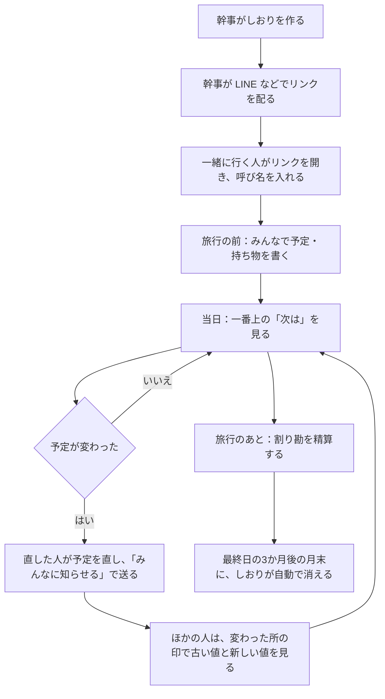
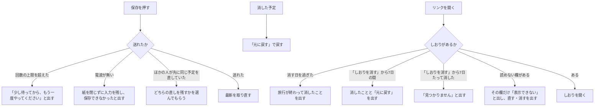

# 要件定義: 段取りさん

## 1. 目的と範囲

### 背景と目的

グループ旅行の予定は、LINE のトークや表計算のファイルに散らばりやすい。
当日に予定が変わると、駅のホームや移動中に LINE を遡って「次は何時にどこ」を探すことになる。
リンクを受け取るのは、親や親戚、職場の人など、新しいアプリを入れたがらない人かもしれない。

段取りさんは、グループ旅行の当日に、みんなが迷わないしおりにする。
しおりの中身（だれが・いつ・どこへ行くか）は、運営者にも読めない形で預かる。

### 利用者

| 利用者 | 目的 |
|---|---|
| 幹事 | しおりを作り、リンクを配って、予定をみんなで書けるようにする |
| 一緒に行く人 | リンクを開いて、登録もアプリも無しで、予定を見て書く。当日は「次は」を確かめる |
| 運営者 | サービスを動かす。しおりの中身は読まない。個人情報の請求と問い合わせに答える |

### 成功の基準

- 初めての幹事が、説明を読まずに、しおりを作ってリンクを送るまで3分以内
- リンクを受け取った人が、開いてから呼び名を入れて予定を見るまで1分以内
- 運営者と D1 のデータから、しおりの中身を読めない（NFR-001）

### 対象外

- ログイン・会員登録
- リアルタイムの配信（開いたときと戻ってきたときに最新を取る）
- 海外の旅行（「当日」「いま」「あと何分」は日本時間で決める）
- スマホのアプリ（ブラウザで開く）
- 使われ方の計測・広告・外のエラー記録のサービス
- 電波が戻ったときに、保存できなかった入力を自動で送り直すこと
- しおりのリンクの作り直し（あとで作る）
- 呼び名が本人のものかを確かめること

## 2. 制約と前提

### 制約

- 置き場所は Cloudflare Workers、データは Cloudflare D1 の無料プラン。D1 には、1日に読み書きできる行の数と、データベースの大きさに上限がある
- 運営者は1人。問い合わせに返事の期限は約束しない
- 個人情報保護法に従う。開示・訂正・消去の請求は、しおりの画面で見る・直す・消すで受ける
- 対応するブラウザは Safari 17・iOS 17、Chrome と Edge 120、Firefox 125 から
- 鍵はリンクの一部なので、リンクは取り消せない。リンクを知る人は、消える日まで読み書きできる

### 前提

- 使う人は、スマホのブラウザ（iPhone の Safari、Android の Chrome）で開く
- リンクは LINE などで配る。LINE からふだんのブラウザに移るときに、`#` の後ろが残る（iPhone と Android の実機でまだ確かめていない。残らなければ、リンクの配り方を見直す）
- 旅行は国内で、1つのしおりに一緒に行く人は50人まで
- リンクを知る人はだれでも、だれの呼び名でも開ける。「○○さんが直しました」は本人の証にならない
- 使う人が少ないうちは、D1 の無料プランの1日の上限を超えない。超えるほど使われるようになったら、プランと回数の上限を見直す

## 3. 業務フロー

### 主な流れ

### 例外の流れ

## 4. 機能要件

決まりの細かいところは、関連業務の列の `.claude/rules` の章に書く。
優先度は、最初に公開する版で無いと困るものを Must、あるとよいものを Should にする。

### しおりを作る

| ID | 要件 | 受入条件 | 優先度 | 状態 | 関連業務 |
|---|---|---|---|---|---|
| REQ-001 | 幹事が旅の名前・はじめと終わりの日・自分の呼び名を入れて「作る」を押したとき、システムはしおりを作り、幹事を一緒に行く人の1人目にする | Given 決まりに合う旅の名前・日にち・呼び名 When 「作る」を押す Then しおりが開き、一緒に行く人は幹事の1人だけ | Must | 有効 | しおりを作る（code.md 5章） |
| REQ-002 | 作るときの入力が決まりに合わない場合、システムはしおりを作らず、合わない欄の下にどう違うかを文で出す | Given 41文字の旅の名前 When 「作る」を押す Then しおりは作られず、旅の名前の下に40文字までと出る | Must | 有効 | しおりを作る（code.md 5章） |
| REQ-003 | しおりを作ったとき、システムは 128 ビット以上の乱数の鍵を `#` の後ろに置いたリンクを出す | Given しおりを作った Then リンクは `https://dandori-san.com/s` で始まり、`#` の後ろに鍵がある | Must | 有効 | しおりを作る（cloudflare.md 2章） |
| REQ-004 | 幹事が「リンクを送る」を押したとき、システムはしおりのリンクを入れて端末の共有の画面を開く | Given 共有の画面を開けるブラウザ When 「リンクを送る」を押す Then 共有の画面が開き、`?openExternalBrowser=1#` の後ろに鍵があるリンクが入っている | Must | 有効 | しおりを作る（cloudflare.md 2章） |
| REQ-005 | 共有の画面を開けないブラウザの場合、システムはリンクをコピーし、コピーしたことを伝える | Given 共有の画面を開けないブラウザ When 「リンクを送る」を押す Then リンクがコピーされ、コピーしたことが読み上げにも伝わる | Must | 有効 | しおりを作る（features.md 5章） |
| REQ-006 | しおりの中身を保存するとき、システムは端末で暗号にしてから送る | Given 旅の名前「作り話の合宿」 When しおりを作る Then サーバーへ送る本文と D1 の行に「作り話の合宿」と鍵が無い | Must | 有効 | しおりを作る・書く（cloudflare.md 2章） |
| REQ-052 | システムは、プライバシーポリシー・利用規約・問い合わせ先のページを、JS が無くても読める形で出す | Given JS を切ったブラウザ When プライバシーポリシー・利用規約・問い合わせ先のページを開く Then どれも本文が読める | Must | 有効 | しおりの外のページ（sveltekit.md 2章、cloudflare.md 7章） |
| REQ-053 | JS が無いブラウザでしおりのページを開いた場合、システムは JS を有効にすれば見られることを出す | Given JS を切ったブラウザ When しおりのリンクを開く Then JS を有効にすれば見られると出る | Must | 有効 | しおりを開く（sveltekit.md 2章） |
| REQ-007 | システムは、しおりを作るときと書くときの画面に、プライバシーポリシーへのリンクを置く | Given しおりを作る画面と名前を入れる画面 Then 送るボタンの下に、プライバシーポリシーへのリンクがある | Must | 有効 | しおりを作る（features.md 9章） |

### 名前を入れる

| ID | 要件 | 受入条件 | 優先度 | 状態 | 関連業務 |
|---|---|---|---|---|---|
| REQ-008 | 呼び名を覚えていない端末でリンクを開いたとき、システムは幹事の呼び名・旅の名前・日にちを出して、呼び名を聞く | Given 初めて開く端末 When リンクを開く Then 幹事の呼び名・旅の名前・日にちと、呼び名の入力欄が出る | Must | 有効 | 名前を入れる（features.md 6章） |
| REQ-009 | 呼び名を聞く画面で、もう加わった人の名前を押したとき、システムはその人としてしおりを開く | Given 加わった人「はな」 When 「はな」を押す Then 「はな」としてしおりが開き、一緒に行く人は増えない | Must | 有効 | 名前を入れる（features.md 6章） |
| REQ-010 | 呼び名を入れた端末でリンクを開いたとき、システムは呼び名を聞かずに、その人としてしおりを開く | Given 「はな」として開いたことのある端末 When リンクを開く Then 呼び名を聞かれず、「はな」として開く | Must | 有効 | 名前を入れる（features.md 6章） |
| REQ-011 | 入れた呼び名が、全角と半角・大文字と小文字・空白だけを除いてほかの人と同じ場合、システムは加えずに、同じ呼び名の人がいることを出す | Given 加わった人「Hana」 When 「ｈａｎａ」で加わる Then 加わらず、同じ呼び名の人がいると出る | Must | 有効 | 名前を入れる（code.md 5章） |
| REQ-012 | 一緒に行く人が50人いる場合、システムは人を加えずに、50人までと出す | Given 一緒に行く人が50人 When 51人目が加わる Then 加わらず、50人までと出る | Must | 有効 | 名前を入れる（cloudflare.md 3章） |
| REQ-013 | 一緒に行く人が「足す」で呼び名を入れたとき、システムはその人を一緒に行く人に足し、足した人を残す | Given 「はな」として開いた When 「足す」で「たろう」を入れる Then 一緒に行く人に「たろう」が増え、足した人は「はな」 | Should | 有効 | 名前を入れる（features.md 6章） |
| REQ-014 | システムは、自分の呼び名と、自分が足した人の呼び名にだけ、「直す」と「消す」を出す。幹事には「消す」を出さない | Given 「はな」が「たろう」を足した When 「はな」として一緒に行く人を見る Then 「はな」と「たろう」にだけ「直す」と「消す」が出る | Should | 有効 | 名前を入れる（features.md 6章） |
| REQ-058 | 一緒に行く人の「消す」を押したとき、システムは、その人が立て替えた分も消えることを書いた確かめの画面を出す | Given 「たろう」が 3,000 円を立て替えた When 「たろう」の「消す」を押す Then 確かめの画面に、立て替えも消えることが出る。やめると何も消えない | Should | 有効 | 名前を入れる（features.md 6章） |
| REQ-049 | 一緒に行く人の「消す」を押して確かめたとき、システムはその人を消し、その人が立て替えた分と持ち物のチェックを消して、割る人と持っていく人からも外す | Given 「たろう」が 3,000 円を立て替え、「はな」の立て替えの割る人に入り、「テント」の持っていく人になっている When 「たろう」を消す Then 「たろう」と 3,000 円の立て替えが無くなり、「はな」の立て替えは残りの人で割り直され、「テント」は持っていく人が決まっていない形に戻る | Should | 有効 | 名前を入れる（features.md 6章・8章） |

### 予定

| ID | 要件 | 受入条件 | 優先度 | 状態 | 関連業務 |
|---|---|---|---|---|---|
| REQ-015 | 日・始まりの時刻・終わりの時刻・やること・場所・メモを入れて「足す」を押したとき、システムは予定を足す | Given 1日目・10:00・「集合」 When 「足す」を押す Then 1日目のタブの 10:00 に「集合」が出る | Must | 有効 | 予定（features.md 2章） |
| REQ-016 | 予定を直して保存を押したとき、システムは予定を直す | Given 10:00 の「集合」 When 時刻を 10:30 にして保存する Then 「集合」が 10:30 に出る | Must | 有効 | 予定（features.md 2章） |
| REQ-017 | 予定の「消す」を押したとき、システムは予定を消す | Given 「集合」の予定 When 「消す」を押す Then 「集合」が一覧から無くなる | Must | 有効 | 予定（features.md 5章） |
| REQ-018 | 始まりの時刻が空で、終わりの時刻だけがある場合、システムは保存せずに、その間違いを文で出す | Given 始まりが空・終わりが 12:00 When 保存を押す Then 保存されず、始まりの時刻を入れるよう出る | Must | 有効 | 予定（features.md 2章） |
| REQ-019 | システムは、予定を日ごとのタブに、始まりの時刻の順に並べ、同じ時刻と時刻の無い予定は並び順の順にする | Given 1日目の 14:00・9:00・時刻なしの予定 When 1日目のタブを開く Then 9:00、14:00 の順に並び、時刻なしは「時刻を決めていない予定」に出る | Must | 有効 | 予定（features.md 2章） |
| REQ-020 | 終わりの時刻が始まりより早い場合、システムは次の日に終わる予定として出し、次の日のタブの一番上にも「前の日から」と出す | Given 1日目 23:00〜6:00 の予定 When 1日目と2日目のタブを開く Then 1日目に「23:00〜翌6:00」、2日目の一番上に「前の日から」と出る | Must | 有効 | 予定（features.md 2章） |
| REQ-021 | 予定に場所があるとき、システムは場所の文字で Google マップを検索するリンクを出す | Given 場所「作り話駅」 When 予定を見る Then 「作り話駅」を検索する地図のリンクが出る | Should | 有効 | 予定（features.md 2章） |
| REQ-022 | メモに `http:` か `https:` の URL があるとき、システムはその URL を押せるリンクにする | Given メモに `https://example.com` と `javascript:` の文字 When 予定を見る Then `https://example.com` だけがリンクになる | Should | 有効 | 予定（features.md 2章） |
| REQ-023 | 予定を消した直後、システムは「元に戻す」を、使う人が閉じるまで出す | Given 「集合」を消した When 「元に戻す」を押す Then 「集合」が元の日と時刻に戻る | Should | 有効 | 予定（features.md 5章） |
| REQ-024 | 予定の紙を開いたあとで、ほかの人が同じ予定を先に直していた場合、システムは保存する前に、ほかの人の直しと、どちらを残すかの選びを出す | Given 「はな」が開いたあとに「たろう」が時刻を 9:00 から 9:30 に直した When 「はな」が保存を押す Then 「たろうさんが、時刻を 9:00 → 9:30 に直していました」と、2つの選びが出る | Should | 有効 | 予定（cloudflare.md 1章） |
| REQ-025 | 旅行の日にちを縮めた場合、システムは日にちの外になった予定を消さずに、予定のページの一番下に出す | Given 3日目に予定がある3日の旅行 When 2日に縮める Then 予定は「旅行の日にちの外になった予定」に出て、3日に戻すと3日目に出る | Should | 有効 | 予定（features.md 3章） |

### 当日

| ID | 要件 | 受入条件 | 優先度 | 状態 | 関連業務 |
|---|---|---|---|---|---|
| REQ-026 | 旅行の前の間、システムは予定のページの一番上に「旅行まで あと n 日」を出す | Given 日本時間の今日が、はじめの日の3日前 When 予定のページを開く Then 一番上に「旅行まで あと 3 日」が出る | Must | 有効 | 当日（features.md 1章） |
| REQ-050 | 旅行のあとの間と、当日に次の予定が無い間、システムは予定のページの一番上に何も出さない | Given 当日の最後の予定が始まったあと When 予定のページを開く Then 一番上に「次は」も「あと n 日」も出ない | Must | 有効 | 当日（features.md 1章） |
| REQ-027 | 当日の間、システムは予定のページの一番上に、次の予定の時刻・あと何分・やること・場所と地図を出す | Given 今が 9:50、次の予定が 10:00 の「集合」 When 予定のページを開く Then 一番上に 10:00・あと 10 分・「集合」・場所が出る | Must | 有効 | 当日（features.md 1章・2章） |
| REQ-028 | 当日の間、システムは今の予定に「いま」の印を付ける | Given 今が 10:30、10:00〜11:00 の予定 When 予定のページを開く Then その予定に緑の線と「いま」が出る | Must | 有効 | 当日（features.md 2章） |
| REQ-029 | ほかの人が前日か当日に予定の時刻か場所を直したとき、システムは最初の値に二重線を引き、今の値を朱で出し、直した人を並べる | Given 当日に「たろう」が 9:00 を 9:30 に直した When 「はな」が予定を見る Then 9:00 に二重線、9:30 が朱、「たろう」が出る | Must | 有効 | 変わった所（features.md 4章） |
| REQ-055 | 直したのが自分の場合か、直したのがやることかメモだけの場合か、前日より前の直しの場合、システムは変わった所の印を出さない | Given 「はな」が当日に 9:00 を 9:30 に直した When 「はな」が予定を見る Then 印は出ない。「たろう」がメモだけを直したときと、2日前に時刻を直したときも出ない | Must | 有効 | 変わった所（features.md 4章） |
| REQ-030 | 直した値が最初の値に戻ったか、最後の直しから24時間たった場合、システムは変わった所の印を消す | Given 9:00 → 9:30 の印 When 9:00 に戻すか、24時間たつ Then 印が消える | Must | 有効 | 変わった所（features.md 4章） |

### みんなに知らせる・最新にする

| ID | 要件 | 受入条件 | 優先度 | 状態 | 関連業務 |
|---|---|---|---|---|---|
| REQ-031 | 予定の時刻か場所を直して保存したときか、予定を消したとき、システムは画面の下に「みんなに知らせる」を出す | Given 予定の時刻を直すか、予定を消した When 保存するか消す Then 「みんなに知らせる」が出る。やることだけを直したときは出ない | Must | 有効 | 知らせる（features.md 5章） |
| REQ-032 | 「みんなに知らせる」を押したとき、システムは変わる前と後・消した予定・しおりのリンクを入れた文で、端末の共有の画面を開く。開けないブラウザではその文をコピーする | Given 9:00 → 9:30 に直した When 「みんなに知らせる」を押す Then 共有の画面の文に 9:00・9:30・しおりのリンクが入っている | Must | 有効 | 知らせる（features.md 5章） |
| REQ-033 | しおりを開いたとき・ほかのアプリやタブから戻ってきたとき・自分が書いたあと、システムは最新のしおりを取り直す | Given 「たろう」が予定を足した When 「はな」がほかのアプリから戻る Then 「たろう」の予定が出る | Must | 有効 | 取り直す（cloudflare.md 5章） |
| REQ-034 | 当日で画面が見えている間に、ほかの人が予定を直した場合、システムは画面を入れ替えずに、「ほかの人が予定を直しました」と「最新にする」を出す | Given 当日に開いている画面 When 「たろう」が予定を直し、3分が過ぎる Then 「最新にする」が出て、押すまで一覧は変わらない | Must | 有効 | 取り直す（cloudflare.md 5章） |

### 持ち物・割り勘

| ID | 要件 | 受入条件 | 優先度 | 状態 | 関連業務 |
|---|---|---|---|---|---|
| REQ-035 | 持ち物を「みんなで使うもの」か「それぞれ持っていくもの」に分けて足したとき、システムはみんなに同じ一覧を出す | Given 「はな」が「テント」をみんなで使うものに足した When 「たろう」が持ち物を開く Then 「テント」がみんなで使うものに出る | Should | 有効 | 持ち物（features.md 7章） |
| REQ-036 | 持ち物のチェックを押したとき、システムはその人のチェックだけを変え、画面には自分のチェックだけを出す | Given 「はな」が「タオル」にチェックした When 「たろう」が持ち物を開く Then 「たろう」の「タオル」はチェックされていない | Should | 有効 | 持ち物（features.md 7章） |
| REQ-047 | 持ち物の「直す」か「消す」を押したとき、システムはその持ち物を直すか消す | Given 「テント」の持ち物 When 「消す」を押す Then 一覧から「テント」が無くなる | Should | 有効 | 持ち物（features.md 7章） |
| REQ-037 | 立て替えを足したとき、システムは1人あたりの額と、払う回数が少ない精算を出す | Given 3人で割る 10,000 円の立て替え When 割り勘を開く Then 1人あたり 3,333 円が出て、余りの1円は立て替えた人が持つ | Should | 有効 | 割り勘（features.md 8章） |
| REQ-048 | 立て替えの「直す」か「消す」を押したとき、システムはその立て替えを直すか消し、精算を計算し直す | Given 10,000 円の立て替え When 金額を 9,000 円に直す Then 1人あたりと精算が 9,000 円で計算し直される | Should | 有効 | 割り勘（features.md 8章） |
| REQ-038 | 精算の行の「払った」を押したとき、システムは押した人の呼び名と一緒に、払ったことを出す | Given 「はな」から「たろう」への精算 When 「じろう」が「払った」を押す Then 「払いました（じろうさんが書きました）」が出る | Should | 有効 | 割り勘（features.md 8章） |

### 電波が無いとき

| ID | 要件 | 受入条件 | 優先度 | 状態 | 関連業務 |
|---|---|---|---|---|---|
| REQ-039 | 電波が無いとき、システムは最後に見たしおりを、いつの状態かと一緒に出す | Given 10:05 に開いたしおり When 電波を切って開き直す Then しおりと「10:05 の時点のしおりです」が出る | Should | 有効 | 電波が無いとき（cloudflare.md 6章） |
| REQ-040 | 電波が無くて保存できない場合、システムは紙を閉じずに入力を残し、保存できなかったことを出す | Given 電波が無い When 予定を直して保存を押す Then 紙は開いたままで、入れた値が残り、「電波がないので、保存できませんでした」と出る | Should | 有効 | 電波が無いとき（cloudflare.md 6章） |

### しおりを消す・守る

| ID | 要件 | 受入条件 | 優先度 | 状態 | 関連業務 |
|---|---|---|---|---|---|
| REQ-041 | 消す日（最終日の3か月後の月末）になったとき、システムはしおりを消したものとして扱う | Given 最終日が 3月10日のしおり When 日本時間で 6月30日に開く Then しおりは開けず、消したことが出る | Must | 有効 | 自動削除（cloudflare.md 4章） |
| REQ-046 | システムは、日本時間で1日1回、消す日になったしおりと、「しおりを消す」から7日たったしおりを、中身と一緒に D1 から消す | Given 消す日が 6月30日のしおり When 日本時間の 7月1日の自動削除が終わる Then D1 にそのしおりの行と中身の行が無い。11月1日に「しおりを消す」を押したしおりも、11月8日の自動削除のあとに無い | Must | 有効 | 自動削除（cloudflare.md 4章） |
| REQ-042 | 消す日を過ぎて自動で消したしおりのリンクを開いた場合、システムは旅行が終わって消したことを出す | Given 消す日を過ぎて自動で消したしおりのリンク When 開く Then 「旅行が終わって3か月たったので、このしおりは消しました」と出る | Must | 有効 | 自動削除（cloudflare.md 4章） |
| REQ-043 | リンクを知る人が「しおりを消す」を押して確かめたとき、システムはしおりを消したものとして扱う | Given 予定のあるしおり When 「しおりを消す」を押し、確かめの画面で消す Then しおりの中身は見えず、「このしおりは消しました」と出る | Must | 有効 | しおりを消す（features.md 9章） |
| REQ-056 | 「しおりを消す」から7日たって消したしおりのリンクを開いた場合、システムは打ちまちがえたリンクと同じく「見つかりません」と出す | Given 11月1日に消したしおり When 11月8日の自動削除のあとにリンクを開く Then 「見つかりません」と出て、「元に戻す」は出ない | Must | 有効 | しおりを消す（cloudflare.md 4章） |
| REQ-051 | 「しおりを消す」から7日の間にリンクを開いたとき、システムは消したことと「元に戻す」を出す | Given 11月1日に消したしおり When 11月7日にリンクを開いて「元に戻す」を押す Then しおりが消す前の中身で開く | Must | 有効 | しおりを消す（features.md 9章） |
| REQ-044 | 読めない欄か決まりに合わない欄がある場合、システムはしおり全体を止めずに、その欄だけを「表示できない」と出す | Given 呼び名の1つが読めないしおり When 開く Then ほかの欄は見えて、その呼び名だけ「表示できない名前」と出る | Must | 有効 | しおりを開く（features.md 9章） |
| REQ-057 | 読めない欄があるとき、システムはその欄に、読めるときと同じ決まりで「直す」と「消す」を出す | Given 「はな」が足した「たろう」の呼び名と、幹事の呼び名が読めない When 「はな」として開く Then 「たろう」の所に「直す」「消す」が出る。幹事が自分の読めない呼び名を見ると、「直す」だけが出る | Must | 有効 | しおりを開く（features.md 6章・9章） |
| REQ-054 | しおりごとの1日の書き込みか、サービス全体の1日のしおりの作成が上限を超えた場合、システムは保存せずに、今日はこれ以上できないことを出す | Given 同じしおりに日本時間の今日1,000回書き込んだ When 1,001回目の保存を押す Then 保存されず、今日はこれ以上書けないと出る。サービス全体で今日500件のしおりが作られたあとも、同じように作れない | Must | 有効 | しおりを作る・書く（cloudflare.md 3章） |
| REQ-045 | しおりの作成か書き込みが回数の上限を超えた場合、システムは保存せずに「少し待ってから、もう一度やってください」と出す | Given 同じしおりに60秒で30回書き込んだ When 31回目の保存を押す Then 保存されず、その文が出る | Must | 有効 | しおりを作る・書く（cloudflare.md 3章） |

## 5. 非機能要件（該当するものだけ）

| ID | 品質特性 | 要件 | 測り方 |
|---|---|---|---|
| NFR-001 | セキュリティ | D1 のデータと運営者から、しおりの中身・札・鍵を読めない | D1 のテスト（中身と札をそのまま置かない）、E2E（読み書きのリクエストに鍵と中身が入らない） |
| NFR-002 | セキュリティ | 1つのしおりのリンクで、ほかのしおりを読む・書くことができない | D1 のテスト（ほかの札・ほかのしおりの ID では0件） |
| NFR-003 | セキュリティ | しおりの鍵は 128 ビット以上の乱数で、表の ID も連番にしない | 単体テスト |
| NFR-004 | インタラクション能力 | WCAG 2.1 レベル AA を、ライトとダークの両方で満たす | E2E の axe、VoiceOver と TalkBack で一通り触る |
| NFR-005 | インタラクション能力 | 横幅 320px でも、文字を 200% にしても、横スクロールなしで読める | E2E（幅と拡大を変えて、はみ出しが無いか見る） |
| NFR-006 | 性能効率性 | Lighthouse のモバイルの設定（Slow 4G）で、しおりのページの LCP が 3 秒以内 | Lighthouse をモバイルの設定で流す |
| NFR-007 | 性能効率性 | しおりのページで読み込む JS は、圧縮して合計 150KB 以内 | build のあとに大きさを数える |
| NFR-008 | 互換性 | Safari 17・iOS 17、Chrome と Edge 120、Firefox 125 から動く | E2E を Chromium と WebKit（iPhone）で流す |
| NFR-009 | セキュリティ | しおりのページとデータの応答に、CSP・`Referrer-Policy: no-referrer`・`X-Robots-Tag: noindex`・`Cache-Control: private, no-store, no-transform` を付ける | E2E（build したものの応答ヘッダーを見る） |
| NFR-010 | セキュリティ | URL・札・リクエストの本文を、ログとエラーの文に出さない | 単体テスト（エラーの記録に札と URL が入らない）、`wrangler.jsonc` でログを切っていることを人の目で見る |
| NFR-011 | セキュリティ | 読み書きの口は、16KiB を超える本文に 413、形の合わない札に D1 を読まずに 401、自分のドメインでない `Origin` の書き込みに 403 を返し、GET では書かない | 読み書きの口のテスト |

## 6. 用語集

| 用語 | 意味 | コードでの名前 |
|---|---|---|
| しおり | 1つの旅行の予定・持ち物・割り勘をまとめたもの。リンク1つにつき1つ | `trip` |
| 幹事 | しおりを作った人 | `trip.organizerId` |
| 一緒に行く人 | しおりに呼び名を入れた人と、「足す」で足した人 | `member` |
| 呼び名 | しおりの中で使う名前。本名でなくてよい | `member.name` |
| 鍵 | リンクの `#` の後ろにある乱数。しおりの中身を暗号にする元になる。端末の中だけで使う | `tripKey` |
| 札 | 鍵から作る、しおりに入るための値。サーバーに送るのはこれだけ | `accessToken` |
| 旅行の前・前日・当日・旅行のあと | 日本時間の今日と、旅行の日にちで決める区切り（features.md 1章） | `phase` の `before`・`during`・`after` |
| 次は | 当日、今より後に始まるいちばん早い予定 | `nextPlan` |
| いま | 当日、今の時刻を含む予定 | `currentPlan` |
| 変わった所の印 | ほかの人が直した予定の、古い値の二重線と、朱の新しい値 | `changed` |
| 消す日 | しおりを自動で消す日。最終日の3か月後の月の末日 | `trip.deleteOn` |
| 精算 | 割り勘で、だれがだれにいくら払うか | `settlement` |
