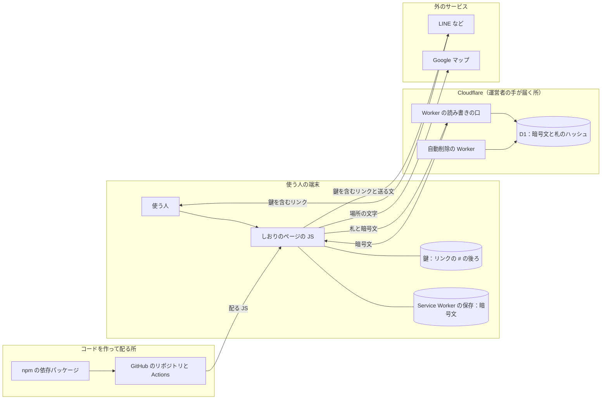

# 脅威モデル: 段取りさん

## 1. 前提

段取りさんの仕様として許していることと、受け入れている危険を、ここに書く。
ここに書いたことは、脅威として扱わない。

- しおりのリンクを知っている人は、だれでも見て書ける。
  ログインは無く、リンクの `#` の後ろの鍵が、しおりに入る鍵の代わりになる（cloudflare.md 2章）
- 鍵は端末の中だけで使い、サーバーには送らない。
  しおりの中身は端末で暗号にしてから送り、D1 には暗号文だけを置く。
  運営者にも中身は読めない（cloudflare.md 2章）
- リンクを持つ人が、まちがえたり、いたずらしたりして中身を書き換えるのは、止めない。
  しおりを消すことも、リンクを知る人はだれでもできる（features.md 9章）
- 呼び名は、選ぶだけでその人として開ける。
  本人かどうかは確かめず、「○○さんが直しました」も本人の証にしない（features.md 6章）
- 精算の「払った」は、だれでも押せる。
  押した人の呼び名を残す（features.md 8章）
- 「リンクを送る」と「みんなに知らせる」の文には、しおりのリンクを入れる。
  送った相手から先にリンクが広がるかは、使う人が決める
- サイトを落とすほどの大量の通信（DDoS）は、Cloudflare が受ける（cloudflare.md 3章）
- 端末そのものの乗っ取り、送り先のサービス（LINE など）の中、Cloudflare と GitHub の基盤の中は、ここでは扱わない

受け入れている危険（cloudflare.md 2章）。

- 運営者の配る JS が書き換えられると、端末で鍵を抜かれうる。
  そのため、Cloudflare・GitHub・npm のアカウントの守り方を決め（cloudflare.md 2章）、依存パッケージと CI を下の表のとおりに守る
- 鍵はリンクの一部なので、端末の履歴・ブックマーク・リンクを貼った LINE の中には残る
- リンクは取り消せない。
  グループを抜けた人や、リンクが漏れた先も、消える日まで読み書きできる
- D1 を書き換えられる人が、暗号文と版の番号を一緒に前の値に戻す（巻き戻す）ことまでは防げない

## 2. 守るもの

- しおりの鍵（リンクの `#` の後ろ）と、鍵から作る暗号の鍵
- しおりに入るための札（鍵から作り、サーバーに送る値）
- しおりの中身（旅の名前・日にち・呼び名・予定・場所・持ち物・立て替え・直した記録）。
  旅行の日にちと場所から、家を空ける日が分かる
- 旅行の当日に、しおりが開けて、正しい中身であること
- D1 の大きさと1日の読み書きの上限（使い切られると、みんなが使えなくなる）
- Cloudflare の API トークンなどの秘密の値と、公開の仕組み
- 配る JS と依存パッケージ（悪いコードが入ると、端末で鍵を抜かれる）

## 3. 攻める人

- しおりのリンクを持つ、一緒に行く人
- 転送や画面の写しで、しおりのリンクを手に入れた第三者
- リンクを持たない外の人（鍵や札を当てずっぽうに試す人を含む）
- D1 のデータを手に入れた人、D1 を書き換えられる人
- 公開のリポジトリに Pull Request を送る外の人
- 依存パッケージ、GitHub Actions、CI のコンテナのイメージを乗っ取った人

## 4. 入口

今ある入口だけを書く。
画面・読み書きの口・Service Worker・自動削除の Worker は、作る Pull Request で、その脅威と一緒にここへ足す。

- しおりのリンク（`#` の後ろの鍵）と、端末の中の暗号
- D1 に置く記録（暗号文・札のハッシュ・ID・版の番号）
- Cloudflare の側に残る記録（ログ・トレース・Logpush）
- 依存パッケージ（npm）、GitHub Actions、CI のコンテナのイメージ
- リポジトリへの Pull Request

## 5. データの流れと信頼の境界

図は、作り終えたときの全体を描く。

信頼の境界は、囲みの間の線。

- 端末と Cloudflare の間：サーバーは、届いた記録を信じず、形を確かめる。
  端末は、サーバーと D1 を中身について信じない。
  鍵を渡さず、届いた暗号文は追加データで確かめてから読む
- 同じしおりのリンクを持つほかの人：D1 から届く中身は、ほかの人がわざと決まりに合わない形で書いたものかもしれない。
  端末は、読んだあとにもう一度確かめる
- 端末と外のサービスの間：送る文とリンクは、LINE などに渡ったら運営者の手が届かない（1章の受け入れている危険）
- コードを作って配る所と端末の間：配る JS が書き換えられると、端末の中の鍵に届く（1章の受け入れている危険）。
  依存パッケージと CI は、6章の表のとおりに守る

## 6. 脅威と対策

分類は STRIDE（なりすまし・改ざん・否認・情報の漏えい・サービスの妨害・権限の昇格）。
否認は、呼び名が本人の証にならないことを仕様として許しているので（1章）、表に無い。

検知は、Pull Request と main への push で動く CI の検査（OSV-Scanner は週に1回も動く）と、GitHub の Secret scanning と Push protection。
単体のテストと D1 のテストは、CI の `npm test` で動く。

### しおりの鍵と暗号

| 脅威 | 分類 | 起きること | 今の対策（ルールのファイルと章） | 検知の方法 |
|---|---|---|---|---|
| 鍵を推測できる形で作る | なりすまし | 当てずっぽうで、ほかのしおりを開く | 128 ビット以上の乱数を `crypto.getRandomValues` で作る（cloudflare.md 2章） | 単体テスト（鍵の長さと文字、毎回ちがう鍵） |
| 表の ID を連番や作った時刻にする | 情報の漏えい | ID の大きさから、作った時期や全体の件数が分かる | 全部の ID を端末で作る乱数にする（cloudflare.md 2章） | 単体テスト（ID の範囲、毎回ちがう ID） |
| サーバーに送る札から、鍵や暗号の鍵が分かる | 情報の漏えい | 運営者や D1 を見た人が、中身を読める | 鍵から HKDF で札と暗号の鍵を別々に作り、札だけを送る（cloudflare.md 2章） | 単体テスト（札は鍵と別の値で鍵の文字を含まない、Node の暗号の関数で別に作った値と同じ） |
| D1 のデータが漏れる | 情報の漏えい | 中身と札が読まれ、しおりを開かれる | 中身は暗号文、札は SHA-256 のハッシュだけを置く（cloudflare.md 2章） | D1 のテスト（旅の名前・日にち・呼び名・札を、そのまま置いていない）、単体テスト（暗号文に元の文字が入っていない） |
| D1 を書き換えて、暗号文をほかの列・ほかの行・前の版・ほかのしおりのものに差し替える | 改ざん | 偽の中身や古い中身を見せる | 暗号の追加データに、形の版・列・行の ID・版の番号を入れる（cloudflare.md 2章） | 単体テスト（差し替え・書き換え・前の版に戻すと読めない）、D1 のテスト（呼び名の暗号文の入れ替え、はじめと終わりの日の入れ替え） |
| 暗号文の長さから、中身の文字数が分かる | 情報の漏えい | 呼び名や旅の名前の長さが漏れる | 列ごとに決まった長さまで詰め物をしてから暗号にする（cloudflare.md 2章） | 単体テスト（詰め物の長さ、収まらない中身は暗号にしない） |
| 暗号の形が変わり、前に作ったしおりが読めなくなる | サービスの妨害 | 旅行の当日にしおりが開けない | 形を変えるときは版を上げ、前の版も読めるようにする（cloudflare.md 2章） | 単体テスト（Node の暗号の関数で別に作った暗号文を読む） |

### ほかのしおりと、書き込まれる中身

| 脅威 | 分類 | 起きること | 今の対策（ルールのファイルと章） | 検知の方法 |
|---|---|---|---|---|
| 人が入れた値を SQL の文字につなげて、D1 に好きな SQL を送る | 権限の昇格 | ほかのしおりを読む・書き換える・消す | 値は `?` で書いて `bind()` で渡す（cloudflare.md 1章） | Semgrep（`.semgrep/d1.yml` の `d1-sql-built-from-values`、`p/owasp-top-ten`、`p/default`） |
| 1つのしおりの札で、ID を変えてほかのしおりの人を読む・足す・幹事や足した人として指す | 権限の昇格 | ほかのしおりを見る・壊す | しおりは札のハッシュからだけ決め、ほかの行を指す列は `(trip_id, 〜_id)` の複合の外部キーにする（cloudflare.md 1章） | D1 のテスト（ほかのしおりの人は出さない、ほかのしおりの人を幹事や足した人にできない、ほかの札では見つからない） |
| 形を確かめずに、送られた記録を D1 に書く | サービスの妨害 | 長い値で D1 を埋める。壊れた値で画面が落ちる | サーバーは暗号文の形と長さ・ID・HMAC の形・消す日の範囲を確かめる。D1 の表は `STRICT` にする（cloudflare.md 1章・2章） | 単体テスト（形の違う記録を断る）、D1 のテスト（形の違う暗号文を書く前に断る、`STRICT` と `CHECK` の決まり） |
| 見えない文字・向きを変える文字・全角と半角などで、別の名前に見せかけたり、同じ呼び名を二重に入れたりする | なりすまし | 一緒に行く人をまちがえさせる | 書く前に端末で NFC にそろえて決まりで確かめ、同じ呼び名は NFKC にそろえた HMAC で比べる（code.md 5章） | 単体テスト（入力の決まりの場合分け）、D1 のテスト（形だけが違う呼び名を同じ呼び名として断る） |
| 呼び名の HMAC だけを書き換えて、同じ呼び名を二重に入れる | なりすまし | 一緒に行く人をまちがえさせる | 読むときに、戻した呼び名の HMAC と比べて印を付ける（cloudflare.md 2章） | 単体テスト（HMAC と合わない呼び名に印を付ける） |
| 決まりに合わない中身を直接書き込んで、画面を止める | サービスの妨害 | しおり全体が開けなくなる | 読むときも端末で確かめ、合わない欄だけを読めないものにする（code.md 5章） | 単体テスト（読めない所だけを読めないものにする） |
| 一緒に行く人を際限なく足す | サービスの妨害 | D1 を埋める | 50人までにし、数の確かめと書き込みを1つの SQL で行う（code.md 5章） | D1 のテスト（上限を超えて足せない） |
| 消す日を過ぎたしおりを読ませる | 情報の漏えい | 消すと約束した中身を見せ続ける | 消す日を過ぎたものは、消す前でも消したものとして扱う（cloudflare.md 4章） | D1 のテスト（消す日になったら消したものとして扱う、足せず並べもしない） |
| 日にちを UTC や動いている場所の時刻で決める | サービスの妨害 | 消す日がずれる。当日の判定がずれる | 日にちと時刻は `#lib/time.js` だけで扱い、SQL の今の時刻を使わない（code.md 2章） | ESLint（`getHours()`・`toISOString().slice()`・`new Date('…')`・SQL の `date('now')` などの禁止）、単体テスト（日本時間の日にちの境目、消す日の月末） |
| 人が入れた文字が、HTML として動く | 情報の漏えい | 開いた人の画面で、`#` の鍵を抜かれる | 人が入れた文字を `{@html}` で出さない（sveltekit.md 4章） | ESLint（`svelte/no-at-html-tags`、`innerHTML` などへの代入と `document.write` の禁止） |

### 運営者の側の記録

| 脅威 | 分類 | 起きること | 今の対策（ルールのファイルと章） | 検知の方法 |
|---|---|---|---|---|
| Cloudflare のログ・トレース・Logpush に、札の入ったヘッダーやしおりのパスが残る | 情報の漏えい | Cloudflare のアカウントを見た人に札が渡り、しおりを開かれる | `wrangler.jsonc` で、ログ・トレース・Logpush を明示して切る（cloudflare.md 7章） | qa-reviewer（Pull Request ごとに、秘密の値がログに出ていないかを見る） |

### コードと依存パッケージと CI

| 脅威 | 分類 | 起きること | 今の対策（ルールのファイルと章） | 検知の方法 |
|---|---|---|---|---|
| 目に見えない文字や、文字の向きを変える文字をコードに入れ、レビューで読む人をだます | 改ざん | 見た目と違う動きのコードが入る | 見えない文字は `\u` の書き方にする（code.md 4章） | Semgrep（`.semgrep/hidden-characters.yml`） |
| コメントで ESLint の規則を外し、穴のある書き方を通す | 改ざん | 上の ESLint の検知をすり抜ける | コメントで規則を外せない設定にする（`eslint.config.js` の `noInlineConfig`、Svelte の `svelte-ignore` と HTML の `eslint-disable` の禁止） | ESLint |
| 既知の脆弱性がある版や、悪いコードが入っていると分かっている版の依存パッケージを入れる | 改ざん | 配る JS に悪いコードが入り、端末で鍵を抜かれる | `package-lock.json` をコミットし、CI は `npm ci` で入れる。新しい版は出てから7日待つ（AGENTS.md「依存パッケージの決まり」） | OSV-Scanner（Pull Request ごとと、週に1回） |
| npm に公開されたものと違う中身のパッケージを入れる | 改ざん | 同上 | CI はスクリプトを止めて入れてから確かめる（`npm ci --ignore-scripts`） | `npm audit signatures`（CI） |
| 依存パッケージのインストールのスクリプトで、悪いコードを動かす | 情報の漏えい | CI や手元で悪いコードが動き、秘密の値を抜かれる | スクリプトを動かしてよいパッケージを1つずつ決める（AGENTS.md「依存パッケージの決まり」） | npm（`.npmrc` の `strict-allow-scripts` が、決めていないスクリプトを止める） |
| GitHub Actions のタグを、乗っ取った人が別のコードに差し替える | 改ざん | CI で悪いコードが動く | Actions はタグではなくコミットの SHA で固定し、Dependabot で上げる（AGENTS.md「依存パッケージの決まり」） | Semgrep（`github-actions-mutable-action-tag`） |
| ワークフローの `run` に、外から来た値（Pull Request のタイトルなど）を埋め込む | 権限の昇格 | 外の人の Pull Request から、CI の権限でコマンドを動かされる | 外から来た値を `run` に直接書かない。`pull_request_target` で外のコードを取り出さない | Semgrep（`run-shell-injection`、`github-script-injection`、`pull-request-target-code-checkout`、`workflow-run-target-code-checkout`） |
| Cloudflare の API トークンなどの秘密の値をコミットする | 情報の漏えい | 公開のリポジトリから、Cloudflare を操作される | 秘密の値は `wrangler secret put` で入れ、`wrangler.jsonc` に書かない（cloudflare.md 7章）。`.dev.vars` と `.env` はコミットしない（git-workflow.md「公開してよい情報」） | GitHub の Push protection（push の時点で止める）と Secret scanning（過去の履歴も調べる） |

## 7. 見直し

| 日付 | 見直したこと |
|---|---|
| 2026-11-10 | 初めて書く。中身を端末で暗号にする作りと、そのテストに合わせる |
| 2026-11-11 | データの流れと信頼の境界を足し、脅威に STRIDE の分類を付ける。入口を今あるものだけにし、Cloudflare の側の記録を足す。リンクを知る人はしおりを消せることを、前提に足す |
